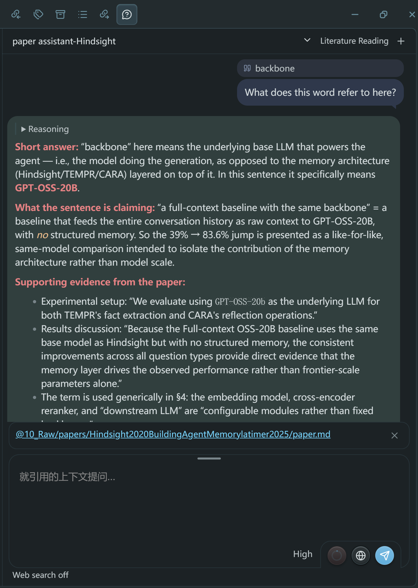

# Quick Ask

**简体中文** · [English](README.md)

### 读到哪里，问到哪里。

为 Obsidian 笔记、论文和图片准备的 AI 侧栏。解释一个术语、对比几篇笔记，或把一节内容变成复习题——拖入材料，就能提问。

[快速开始](#快速开始) · [使用指南](docs/user-guide_zh.md) · [下载](https://github.com/JM-FRANK/obsidian-quick-ask/releases) · [求助与反馈](https://github.com/JM-FRANK/obsidian-quick-ask/issues)

  

## 为什么选择 Quick Ask？

- **少一点复制，多一点阅读。** 把选区或文件拖进侧栏，或输入 `[[` 选择文件。由你决定这段对话能访问哪些笔记。
- **随时接着聊。** 会话保存在本地，原始选区留在对应问题上方，悬浮即可回看全文。
- **自己的模型，自己的问法。** 保存多组连接，支持 Responses 和 Chat Completions；为新会话选择文献阅读、学习出题或自定义角色。
- **不止文字。** 拖入图片、粘贴截图；需要在线信息时，再开启网络搜索。
- **让讨论延续下去。** 跟踪已加入文件的变化，长对话可压缩模型上下文，完整本地历史仍然保留。
- **融入 Obsidian。** 跟随主题的气泡、可读推理、自定义字号，以及可调整高度的输入区。

**轻量：**安装体积约 1.3 MiB（gzip 约 306 KiB）。无遥测，没有开发者运营的后端。

## 快速开始

需要**桌面版 Obsidian 1.13.7+**。

1. 在**设置 → 第三方插件 → 浏览**中搜索 **Quick Ask**，安装并启用。
2. 打开 **Quick Ask → 模型连接**，配置 Base URL 与命名 API 密钥，再选择模型和协议。
3. 打开侧栏，拖入选区或通过 `[[` 添加文件，然后发送问题。

连接／模型和角色的修改仅用于**新会话**。插件免费，需自备提供方 API 访问权限，模型／搜索费用另计。暂不支持移动端和 PDF 输入。

[手动安装与完整配置 →](docs/user-guide_zh.md#安装)

## 进一步了解

- [使用指南](docs/user-guide_zh.md)——模型连接、角色、思考程度、图片、联网、压缩与备份。
- [厂商联网搜索配置](docs/native-search.md)——受支持的端点与凭据配置。
- [更新日志](CHANGELOG.md)——各版本包含的改动。

## 关于你的数据

历史保存在本地。发送问题时，相关上下文会提交给你配置的提供方；模型发现和开启的搜索也会产生网络请求。插件不后台轮询，不能修改笔记或搜索任意 Vault 文件。

[查看网络、费用与隐私详情](docs/user-guide_zh.md#账号费用与网络使用)，包括图片导出内容和缓存保留规则。

## 求助与参与

有疑问、缺陷或新想法？欢迎[提交 issue](https://github.com/JM-FRANK/obsidian-quick-ask/issues)。附上版本与复现步骤；布局问题请带上主题和截图，避免包含密钥或私人笔记。

本地构建与贡献方式见[开发说明](docs/user-guide_zh.md#开发)和[维护流程](docs/maintaining.md)。

## 许可

版权所有 2026 **FRANK-SMITH** · [Apache License 2.0](LICENSE) · [NOTICE](NOTICE)。依赖许可收录于 `main.js` 和 [THIRD_PARTY_NOTICES.md](THIRD_PARTY_NOTICES.md)。
